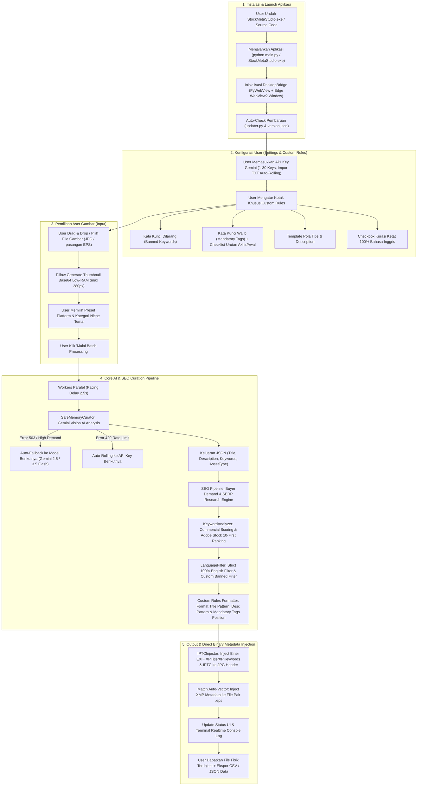
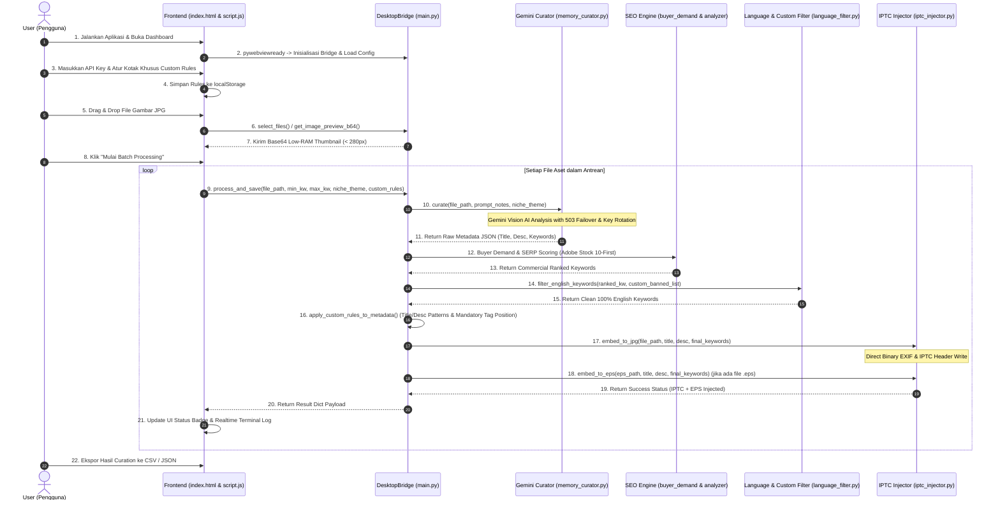

# 🚀 Alur Kerja Lengkap StockMeta Studio (Mermaid Diagram)

Dokumen ini menjelaskan alur kerja aplikasi **StockMeta Studio by BRKH STUDIO (v1.0.3)** dari tahap instalasi pengguna, pengaturan API Key & Kotak Khusus Custom Rules, analisis visual AI Gemini, riset SEO pembeli, hingga penulisan metadata biner langsung ke header file fisik gambar (`.jpg`) dan vektor (`.eps`).

---

## 📊 1. Diagram Alur Utama (End-to-End User Flowchart)

---

## 🔄 2. Sequence Diagram (Detail Interaksi Komponen & IPC Bridge)

---

## 📝 3. Rincian Tahapan Alur Eksekusi Sistem

### Tahap 1: Instalasi & Peluncuran Aplikasi
1. **Pilihan Jalur Eksekusi**:
   - **Standalone Exe**: Pengguna mengunduh `StockMetaStudio.exe` v1.0.3 dan menjalankannya di OS Windows tanpa menginstal Python.
   - **Source Code**: Pengguna menjalankan via `python main.py` menggunakan Python 3.10+.
2. **Auto-Update Check**: Modul `core/updater.py` memeriksa file manifest versi `version.json`. Jika ada rilis baru, banner pemberitahuan pembaruan akan ditampilkan di dashboard UI.

### Tahap 2: Konfigurasi API Key & Kotak Khusus Custom Rules
1. **Manajemen Multi-API Key**: Pengguna memasukkan 1 hingga 30 API Key Gemini (dukungan impor file `.txt`). Sistem akan melakukan rotasi key secara *round-robin* dan otomatis pindah key jika terkena kuota limit (HTTP 429).
2. **Kotak Khusus Custom Rules & Patterns**:
   - 🛑 **Kata Kunci Dilarang (*Banned Keywords*)**: Kata-kata yang wajib dibuang dari hasil output.
   - 📌 **Kata Kunci Wajib (*Mandatory Tags*)**: Kata-kata yang wajib dimasukkan ke setiap file.
   - 🔀 **Checklist Urutan Kata Kunci Wajib**:
     - **Dicentang (`mandatoryAtEnd = true`)**: Kata kunci wajib ditaruh di **urutan akhir** (*tail tags*).
     - **Tidak Dicentang (`mandatoryAtEnd = false`)**: Kata kunci wajib ditaruh di **urutan awal** (*top priority tags*).
   - ✍️ **Template Pola Title & Description**: Penggunaan placeholder `{title}` dan `{description}` untuk menyeragamkan format judul & deskripsi komersial.
   - 🇬🇧 **Kurasi Ketat 100% Bahasa Inggris**: Menyaring kata non-ASCII, membuang kosa kata Bahasa Indonesia, dan mengunci kurasi hanya dalam Bahasa Inggris murni.

### Tahap 3: Pemilihan File Gambar & Thumbnail Generation
1. **File Picker Native & Drag-and-Drop**: Pengguna memasukkan file gambar JPG lokal.
2. **Low-RAM Base64 Preview**: Python Pillow menghasilkan thumbnail `BytesIO` Base64 resolusi rendah (max 280px) untuk menjaga penggunaan RAM di bawah 100 MB dan memfasilitasi antarmuka peramban.

### Tahap 4: Kurasi Vision AI, SEO Engine, & Custom Formatting
1. **Gemini Vision AI Curation**: Menggunakan `SafeMemoryCurator` untuk menganalisis subjek visual gambar. Jika server mengalami error 503 (*High Demand*), sistem otomatis beralih (*failover*) ke model kandidat berikutnya (`gemini-2.5-flash`, `gemini-3.5-flash-lite`, `gemini-3.8-flash`).
2. **Buyer Demand & SERP Research**: Meriset kueri pencarian komersial nyata dari Google/Bing.
3. **Commercial Scoring & Adobe Stock 10-First Rule**: Menilai skor komersial kata kunci dan memposisikan 10 tag komersial terbaik di posisi awal.
4. **Strict English & Custom Rule Application**: Menapis kata kunci dilarang, menerapkan format template pola judul/deskripsi, dan mengatur posisi kata kunci wajib (di awal atau di akhir).

### Tahap 5: Output & Direct Binary Metadata Injection
1. **Penulisan Biner EXIF & IPTC**: Library `Pillow` & `iptcinfo3` menginjeksi metadata langsung ke Windows Details Tab (`XPTitle`, `XPSubject`, `XPKeywords`) dan header IPTC biner file `.jpg` tanpa merusak piksel gambar.
2. **Automatic EPS Vector Matching**: Jika terdapat file vektor `.eps` berpasangan di folder yang sama, metadata XMP disuntikkan secara otomatis.
3. **Hasil & Ekspor Data**: Pengguna dapat melihat badge status selesai pada antarmuka, memantau *terminal log console*, serta mengekspor data batch ke format CSV atau JSON.

---

> 💡 **BRKH STUDIO Documentation Notice**: Dokumentasi ini dibuat secara resmi untuk memudahkan pemahaman arsitektur dan alur kerja aplikasi **StockMeta Studio**.
